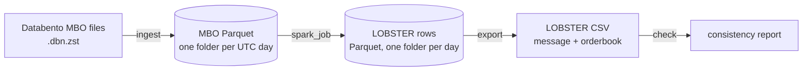

# lob-pipeline

Spark pipeline that turns CME market-by-order data (Databento MBO) into limit order
book files in the [LOBSTER](https://lobsterdata.com) format.

Built on two months of E-mini S&P 500 futures (ES), September and October 2025,
about 486 million order messages.

## How it works



1. `ingest` converts Databento `.dbn.zst` files to Parquet, one partition per UTC day.
2. `spark_job` rebuilds the order book for every instrument-day in parallel. Each MBO
   record becomes zero, one or two LOBSTER events, and each event is written with the
   top 10 price levels after it, between 09:30 and 16:00 New York time.
3. `export` writes the LOBSTER message and orderbook CSV files for the requested days.
4. `check` reads a CSV pair back and confirms every orderbook row follows from its
   message. It takes the opening book and anything below level 10 as given.

Every day in these files starts with a book snapshot (Databento's at 00:00 UTC, or CME's
at the Sunday reopen), so days are independent and can be rebuilt in parallel. The
rebuild refuses a day that does not start with one.

### Inside the Spark job

An order book is stateful: each message is read against the book left by the ones
before it, so the messages of one instrument-day have to be replayed in order by one
worker. The job

1. reads the MBO Parquet and hash-partitions it on `(instrument_id, date)`, so every
   row of an instrument-day lands in the same partition,
2. sorts each partition by `(instrument_id, date, row_nr)`, where `row_nr` is the
   record's position in the original files,
3. runs `mapInPandas`, which streams each partition to a Python worker in Arrow
   batches; the worker starts a new `Book` whenever the instrument-day changes, feeds
   the rows through it and yields LOBSTER rows,
4. writes the result as Parquet partitioned by date.

Spark handles the partitioning, sorting and parallelism; the book logic is plain Python
in `lobpipe/book.py` and is tested without Spark.

On a laptop (Apple M1 Pro, 16 GB, Spark `local[4]`), the full two months take about
4 minutes to ingest and 46 minutes for `spark_job --verify`, which writes 368 million
LOBSTER rows (9 GB of Parquet).

### Layout

```
lobpipe/ingest.py      DBN files -> MBO Parquet
lobpipe/book.py        order book and the MBO -> LOBSTER event rules
lobpipe/transform.py   runs a Book over one instrument-day
lobpipe/spark_job.py   the Spark job
lobpipe/export.py      LOBSTER CSV files
lobpipe/check.py       CSV-only consistency check
scripts/               validation against snapshots and a single-process rebuild
tests/                 unit tests on synthetic data
```

## Usage

Needs Python 3.12+ and Java 17 or 21 for Spark (tested with Java 21).

```
pip install -r requirements.txt
python -m lobpipe.ingest --out data/mbo es-mbo-2025-09.dbn.zst es-mbo-2025-10.dbn.zst
python -m lobpipe.spark_job --src data/mbo --out data/lob --verify
python -m lobpipe.export --src data/lob --out data/lobster --dates 2025-10-01 2025-10-02
python -m lobpipe.check data/lobster/*message_10.csv
```

`--verify` rebuilds the book a second way from adds, cancels and modifies only and
stops if the two disagree after any event. Market data is not included in this repo;
the `.dbn.zst` names above stand for your own Databento files.

## Event mapping

| MBO record | LOBSTER event |
|---|---|
| add | 1 new order |
| cancel | 3 delete |
| modify to a smaller size | 2 partial cancel (3 if the size goes to zero) |
| modify to a new price or a larger size | 3 delete, then 1 new order |
| modify that restores an iceberg's displayed size after a fill | 1 new order |
| fill of a resting order | 4 execution |
| fill beyond an order's displayed size (iceberg reserve) | 5 hidden execution |
| fill against an aggressor's remainder that was never shown in the book | 5 hidden execution |
| cancel or modify that only confirms a fill already written | none |
| fill of the aggressing order, trade summary, snapshot record | none |

Fills of the aggressing order are skipped because LOBSTER records executions on the
resting side. The rebuild raises an error on any sequence it can't explain instead of
guessing.

## Validation

- Every fill has to add up to its trade, and every cancel or modify has to match the
  order it refers to. All 486 million messages pass.
- The book left at the end of a day matches the snapshot that opens the next calendar
  day, order for order (side, price, size), on all 44 such pairs in the data. There is
  no Saturday data, so Friday is never compared with Sunday.
- The Spark output equals a plain single-process rebuild, row for row, on all 53 days
  (368,037,596 rows).
- `check` replays the exported CSV files on their own, with no access to the source data.
- The files load in [LOBFrame](https://github.com/FinancialComputingUCL/LOBFrame)
  (commit `c47549d`), the code behind *Deep Limit Order Book Forecasting* (Briola,
  Bartolucci, Aste), without changes. Its data processing and labels run on ten days of
  output, and DeepLOB trained for one epoch on CPU. Its evaluation stage was not run to
  completion.

The snapshot and Spark comparisons run with:

```
python scripts/check_snapshots.py --mbo data/mbo
python scripts/compare_spark.py --mbo data/mbo --lob data/lob
```

## Tests

```
pytest
```
