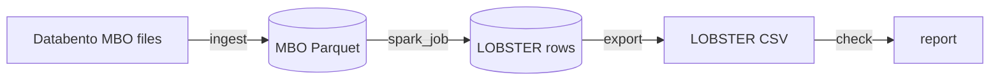

# lob-pipeline

Turns CME market-by-order data (Databento MBO) into [LOBSTER](https://lobsterdata.com)
limit order book files using Apache Spark. Tested on 8 GB of compressed data (486
million order messages).

## How it works



1. `ingest` reads the Databento files and writes them to Parquet, one folder per day.
   Each file is decoded in its own Spark task, and every record gets a `row_nr` so the
   original order is never lost.
2. `spark_job` rebuilds the order book for every instrument and day, and writes a
   LOBSTER event for each change with the top 10 price levels after it (09:30 to 16:00
   New York time).
3. `export` writes the LOBSTER message and orderbook CSV files for the days you pick.
4. `check` reads the CSV files back and confirms every book row follows from its message
   (within the visible 10 levels, starting from the first row).

An order book has state, so the messages of one day have to be processed in order by
one worker. This still runs in parallel because every day starts with a full snapshot of
the book: Spark partitions the data by instrument and day, sorts it by instrument, day
and `row_nr`, and `mapInPandas` streams it through a `Book` (`lobpipe/book.py`), which is
plain Python and tested without Spark. A day that can't be rebuilt, for example one with
a missing snapshot, is marked as failed in `_status.json` and the rest of the run goes on.

On my laptop (M1 Pro, 16 GB, Spark `local[4]`) that data takes about 3 minutes to
ingest and 50 minutes to rebuild with `--verify`, giving 368 million LOBSTER rows.

## How to use

You need Python 3.12+ and Java 17 or 21 (or just Docker, see below).

1. Install the packages:
   ```
   pip install -r requirements.txt
   ```
2. Download MBO data from Databento in DBN format (`.dbn.zst`, split by day) and put the
   files in `data/dbn/`. No market data is included in this repo.
3. Convert the files to Parquet:
   ```
   python -m lobpipe.ingest --out data/mbo data/dbn/
   ```
4. Rebuild the order books. `--verify` double-checks every event but is slower. The job
   prints how many instrument-days were rebuilt and why any failed.
   ```
   python -m lobpipe.spark_job --src data/mbo --out data/lob --verify
   ```
5. Export the days you want as LOBSTER CSV files, e.g.
   `ES_2025-10-01_34200000_57600000_message_10.csv` and the matching `orderbook` file:
   ```
   python -m lobpipe.export --src data/lob --out data/lobster --dates 2025-10-01 2025-10-02
   ```
6. Optionally, check the CSV files:
   ```
   python -m lobpipe.check data/lobster/*message_10.csv
   ```

Run the tests with `pytest` (the S3 test also needs `requirements-dev.txt`).

## Bigger data

- Ask Databento for files split by day. Ingest decodes each file in its own task and the
  rebuild keeps each instrument-day together in one task, so both spread over cores or
  machines.
- `ingest` and `spark_job` can read and write `s3://bucket/...` paths, using the usual
  AWS credentials. Writes go through the S3A "magic" committer since S3 has no rename.
- The Docker image has Java, Spark and the S3 jars:

  ```
  docker build -t lobpipe .
  docker run --rm -v "$PWD/data:/data" lobpipe lobpipe.ingest --out /data/mbo /data/dbn/
  ```

- On a cluster, zip the `lobpipe` folder and run `spark-submit --py-files lobpipe.zip
  lobpipe/spark_job.py ...`; the executors need the packages in `requirements.txt`, and
  S3 needs the jars listed in `lobpipe/spark.py`. I've only run this with a local master.

## Event mapping

| MBO record | LOBSTER event |
|---|---|
| add | 1 new order |
| cancel | 3 delete |
| modify to a smaller size | 2 partial cancel (3 if the size goes to zero) |
| modify to a new price or a larger size | 3 delete, then 1 new order |
| modify that restores an iceberg's displayed size after a fill | 1 new order |
| fill of a resting order | 4 execution |
| fill beyond an order's displayed size (iceberg reserve) | 5 hidden execution |
| fill against an aggressor's remainder that was never shown in the book | 5 hidden execution |
| cancel or modify that only confirms a fill already written | none |
| fill of the aggressing order, trade summary, snapshot record | none |

LOBSTER records executions on the resting side, so fills of the aggressing order are
skipped. The rebuild fails on sequences it doesn't handle instead of guessing.

## Validation

- Fill quantities add up to each trade and every cancel or modify matches its order,
  for all 486 million messages.
- The book at the end of each day matches the snapshot that opens the next day, order
  for order, on all 44 consecutive day pairs
  (`python -m scripts.check_snapshots --mbo data/mbo`).
- The Spark output matches a plain single-process rebuild row for row on all 53 days
  (`python -m scripts.compare_spark --mbo data/mbo --lob data/lob`).
- Running the pipeline in Docker, and against a local S3 server, gives byte-identical CSV
  files.
- The CSV files load in [LOBFrame](https://github.com/FinancialComputingUCL/LOBFrame),
  the code from *Deep Limit Order Book Forecasting* (Briola, Bartolucci, Aste). I ran its
  preprocessing on ten days and trained DeepLOB for one epoch.

Limits: only ES outright futures. Calendar spreads, which can trade at zero or below,
come out as failed days, and Databento files from before February 2024 are untested.
