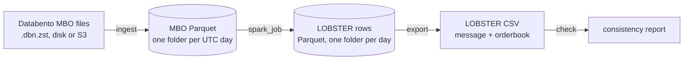

# lob-pipeline

Spark pipeline that turns CME market-by-order data (Databento MBO) into limit order
book files in the [LOBSTER](https://lobsterdata.com) format. It runs on a laptop or a
Spark cluster, with the data on local disk or S3.

Built on two months of E-mini S&P 500 futures (ES), September and October 2025,
about 486 million order messages.

## How it works



1. `ingest` is a Spark job that converts Databento files to Parquet, one folder per UTC
   day. It reads every file's header to put the files in time order, then decodes each
   file in its own task. `row_nr` (file number and position in the file) keeps the
   original order of every record.
2. `spark_job` rebuilds the order book for every instrument-day in parallel. Each MBO
   record becomes zero, one or two LOBSTER events, and each event is written with the
   top 10 price levels after it, between 09:30 and 16:00 New York time.
3. `export` writes the LOBSTER message and orderbook CSV files for the days you choose.
4. `check` reads a CSV pair back and confirms every orderbook row follows from its
   message. It takes the opening book and anything below level 10 as given.

Every day in these files starts with a book snapshot (Databento's at 00:00 UTC, or CME's
at the Sunday reopen), so days are independent and can be rebuilt in parallel.

### Inside the Spark job

An order book is stateful: each message is read against the book left by the ones
before it, so the messages of one instrument-day have to be replayed in order by one
worker. The job

1. reads the MBO Parquet and hash-partitions it on `(instrument_id, date)`, so every
   row of an instrument-day lands in the same partition,
2. sorts each partition by `(instrument_id, date, row_nr)`,
3. runs `mapInPandas`, which streams each partition to a Python worker in Arrow
   batches; the worker starts a new `Book` whenever the instrument-day changes, feeds
   the rows through it and yields LOBSTER rows,
4. writes the result as Parquet partitioned by date.

Spark handles the partitioning, sorting and parallelism; the book logic is plain Python
in `lobpipe/book.py` and is tested without Spark.

Each instrument-day ends with a status row: `ok`, or the reason its book could not be
rebuilt (a missing snapshot, a sequence the rules can't explain). A failed day doesn't
stop the run. It is listed in `_status.json`, export and `compare_spark` leave it out,
and `spark_job` exits with 1 unless `--allow-failed-days` is given.

On a laptop (Apple M1 Pro, 16 GB, Spark `local[4]`), the two months, as 53 daily files,
take under 3 minutes to ingest and about 50 minutes for `spark_job --verify`, which
writes 368 million LOBSTER rows (9 GB of Parquet).

### Layout

```
lobpipe/ingest.py      DBN files -> MBO Parquet
lobpipe/book.py        order book and the MBO -> LOBSTER event rules
lobpipe/transform.py   replays one instrument-day through a Book, keeping its first error
lobpipe/spark_job.py   the Spark job
lobpipe/spark.py       Spark session, with the S3 settings
lobpipe/export.py      LOBSTER CSV files
lobpipe/check.py       CSV-only consistency check
lobpipe/fs.py          local paths and s3:// URIs
scripts/               validation against snapshots and a single-process rebuild
tests/                 unit tests on synthetic data
Dockerfile             Java, Python, Spark and its S3 jars
```

## Usage

Needs Python 3.12+ and Java 17 or 21 for Spark (tested with 21 locally and 17 in the
Docker image), or Docker.

```
pip install -r requirements.txt
python -m lobpipe.ingest --out data/mbo data/dbn/
python -m lobpipe.spark_job --src data/mbo --out data/lob --verify
python -m lobpipe.export --src data/lob --out data/lobster --dates 2025-10-01 2025-10-02
python -m lobpipe.check data/lobster/*message_10.csv
```

`data/dbn/` is a folder of Databento MBO files (`.dbn.zst`); market data is not included
in this repo. `--verify` rebuilds the book a second way from adds, cancels and modifies
only and stops that day if the two disagree after any event.

## Running at scale

- **Files.** Request the Databento files split by day. A compressed file can't be
  split, so in `ingest` one file is one Spark task; in `spark_job` the unit of work is
  one instrument-day.
- **S3.** `ingest` and `spark_job` read and write `s3://bucket/prefix` paths, and
  `export` reads them; the CSV files and `check` stay on local disk. Credentials come
  from the usual AWS environment variables or the machine's role; `AWS_ENDPOINT_URL`
  points at an S3-compatible store instead. Spark writes to S3 through the S3A "magic"
  committer, since S3 has no rename. Started with `python -m`, the first S3 run downloads
  Spark's S3 connector (`hadoop-aws`) from Maven Central; the Docker image already has
  it, and with `spark-submit` you pass the jars yourself (below).
- **Docker.** The image has Java, the Python packages and the S3 jars:

  ```
  docker build -t lobpipe .
  docker run --rm -v "$PWD/data:/data" lobpipe lobpipe.ingest --out /data/mbo /data/dbn/
  docker run --rm -e AWS_ACCESS_KEY_ID -e AWS_SECRET_ACCESS_KEY -e AWS_DEFAULT_REGION \
      lobpipe lobpipe.spark_job --src s3://my-bucket/mbo --out s3://my-bucket/lob
  ```

- **A cluster.** Under `spark-submit` the job keeps spark-submit's master, memory and
  Python settings. Executors need the packages in `requirements.txt` (for example by
  running them from this image) and the `lobpipe` code:

  ```
  zip -r lobpipe.zip lobpipe
  spark-submit --master <cluster> --py-files lobpipe.zip \
      --packages org.apache.hadoop:hadoop-aws:3.5.0 \
      --jars https://repo1.maven.org/maven2/org/apache/spark/spark-hadoop-cloud_2.13/4.2.0/spark-hadoop-cloud_2.13-4.2.0.jar \
      lobpipe/spark_job.py --src s3://my-bucket/mbo --out s3://my-bucket/lob
  ```

  This command was run with a local master and local files only (no S3 jars), not on a
  multi-node cluster.
- **Memory.** A Spark task's memory depends on the live orders of one day and the Arrow
  batch size, not on the size of the dataset. Export holds one
  instrument-day in memory: 3.3 GB at peak for a day of 3.8 million rows.
- **What it covers.** ES outright contracts. A calendar spread trades at zero or below
  on some days; those days are reported as failed, since LOBSTER prices must be
  positive. Databento files from before February 2024 open a day with the snapshot but
  without the "clear book" record; the rebuild accepts that, but it has not been tried
  on real pre-2024 data.

## Event mapping

| MBO record | LOBSTER event |
|---|---|
| add | 1 new order |
| cancel | 3 delete |
| modify to a smaller size | 2 partial cancel (3 if the size goes to zero) |
| modify to a new price or a larger size | 3 delete, then 1 new order |
| modify that restores an iceberg's displayed size after a fill | 1 new order |
| fill of a resting order | 4 execution |
| fill beyond an order's displayed size (iceberg reserve) | 5 hidden execution |
| fill against an aggressor's remainder that was never shown in the book | 5 hidden execution |
| cancel or modify that only confirms a fill already written | none |
| fill of the aggressing order, trade summary, snapshot record | none |

Fills of the aggressing order are skipped because LOBSTER records executions on the
resting side. The rebuild raises an error on any sequence it can't explain instead of
guessing.

## Validation

- Every fill has to add up to its trade, and every cancel or modify has to match the
  order it refers to. All 486 million messages pass, with `--verify`.
- The book left at the end of a day matches the snapshot that opens the next calendar
  day, order for order (side, price, size), on all 44 such pairs in the data. There is
  no Saturday data, so Friday is never compared with Sunday.
- The Spark output equals a plain single-process rebuild, row for row, on all 53 days
  (368,037,596 rows).
- Splitting the two monthly files into 53 daily files changes nothing: the ingested rows
  match the earlier single-process ingest, and the CSV files of the days compared are
  byte-identical. So are the CSV files from the pipeline run inside the Docker image,
  on local files and against a local S3 server.
- `check` replays the exported CSV files on their own, with no access to the source data.
- The files load in [LOBFrame](https://github.com/FinancialComputingUCL/LOBFrame)
  (commit `c47549d`), the code behind *Deep Limit Order Book Forecasting* (Briola,
  Bartolucci, Aste), without changes. Its data processing and labels run on ten days of
  output, and DeepLOB trained for one epoch on CPU. Its evaluation stage was not run to
  completion.

The snapshot and Spark comparisons run with the commands below; on a large dataset, add
`--dates` to check a sample.

```
python -m scripts.check_snapshots --mbo data/mbo
python -m scripts.compare_spark --mbo data/mbo --lob data/lob
```

## Tests

```
pip install -r requirements-dev.txt   # moto, a local S3 server for the S3 test
pytest
```

The first run of the S3 test downloads Spark's S3 jars (about 1 GB) from Maven Central.
